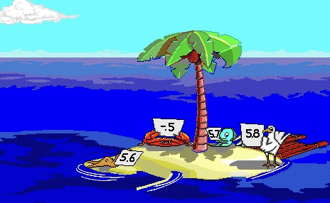
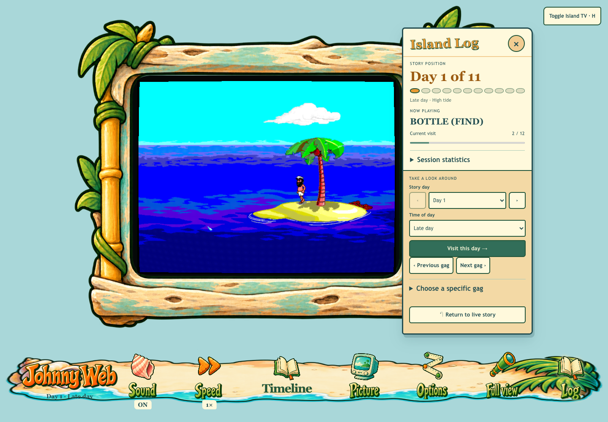

# johnny_web

[Johnny Castaway](https://en.wikipedia.org/wiki/Johnny_Castaway), the 1992 screensaver, running in a browser. This project is a fork of [xesf/castaway](https://github.com/xesf/castaway), modernized with ES modules and Vite. Its experimental JavaScript engine, **Bottle DGDS**, reads the original game data.

<p align="center">
  
</p>

For the story behind the project and its reconstruction, read [Rehabilitating Johnny Castaway for the browser](https://www.allaboutken.com/posts/20261019-johnny-castaway-browser/).

## Run locally

You need **Node.js 24+** and **pnpm 10**.

```bash
pnpm install
pnpm run dev
```

Open [localhost:5173](http://localhost:5173). The original game data is proprietary and isn't included in this repository. Download the Windows 3.1 floppy image ZIP from the [Internet Archive](https://archive.org/details/screen-antics-johnny-castaway-16-color-v1.01-int.-1.4.93-win3.1-1.44m), then drop the ZIP or its extracted `.ima` file into the page. The app extracts and stores the data in your browser. The same import works on a hosted copy of the site.

For tests and command-line tools that need game data, follow the [local extraction instructions](CONTRIBUTING.md#local-game-data). Browser imports don't create files in your checkout.

## Playback

<p align="center">
  
</p>

The Island TV interface, with the Log closed to show the TV controls. Original Johnny Castaway game artwork © Dynamix / Sierra On-Line; the surrounding interface illustrations were created for this project.

Press **Play** to start Johnny with the illustrated Island TV. Fresh preferences use Balanced CRT, a stretch-to-fill picture, drifting clouds and the original story clock. **Options** remembers your choices across visits; **Picture** opens the picture presets. See [CRT setup and controls](docs/optional-crt.md) for models, tuning and fallback behavior.

Use the [playback toolbar and Island Log](docs/playback-toolbar.md) to pause, change speed, hide the cabinet or jump to a gag. The [story timeline](docs/story-timeline-guide.md) (`T`) lets you browse days, times and scenes without interrupting playback until you choose a Play action.

Johnny's [11-day story](docs/story-over-time.md) unfolds across visits, with progress saved in your browser. To change when night falls or explore a particular day/time, see [browsing and playback clocks](docs/story-timeline-guide.md#browsing-and-playback-clocks).

## Development

```bash
pnpm test          # Vitest suite
pnpm run build    # Production build in dist/
pnpm run preview  # Serve the production build locally
```

Start with [Contributing](CONTRIBUTING.md) for the source layout, local data setup, and checks to run before a PR. The [architecture guide](docs/architecture.md) explains how the engine fits together.

See the [changelog](CHANGELOG.md) for what each release changed.

Find player guides, developer tasks, fidelity tools and historical records in the [documentation index](docs/README.md).

## A personal note and acknowledgements

I remember in the early 90s going to the office with one of my parents and seeing this running on a machine as a screensaver. I thought it was really cool! For decades you basically didn't see it anymore, and it's super cool that I can now just have it running in a browser tab for a bit of fun. It was a really fun way to learn more about how these old screensavers worked.

AI was used heavily in building this modernization, and it made the reverse engineering and testing vastly easier than traditional hand-scaling. I managed to complete this effort over a few intense sessions—something that probably would have taken me several weeks of detailed work otherwise.

That being said, while AI was a great accelerator, **none of this would have been possible without the hard work that many others put in first**. A huge thanks to:

- **The Original Creators:** The team at Dynamix / Sierra On-Line—including Jeff Tunnell (producer), Rich Rayl (programming), Sherry Wheeler (animation), Shawn Bird (character design), and Brian Hahn (gags)—for creating such an iconic piece of 90s software.
- **The Reverse Engineers:** The folks who did all the foundational work to decode the DGDS engine formats, including [Alexandre Fontoura](https://github.com/xesf/castaway), [Jérémie Guillaume](https://github.com/jno6809/jc_reborn), [Hans Milling](https://github.com/nivs1978/Johnny-Castaway-Open-Source), [Vasco Costa](https://github.com/vcosta/scummvm/tree/master/engines/dgds), and the [ScummVM team](https://github.com/scummvm/scummvm/tree/master/engines/dgds).
- **The Archivists:** The people who preserved the original floppy disks and uploaded them to the Internet Archive, especially [Greyfalken](https://archive.org/details/@greyfalken).

**Further Reading & History**

If you want to learn more about the history of the screensaver, check out this [great YouTube video](https://www.youtube.com/watch?v=E5lxiTJGqHw), its page on the [Sierra Chest](https://sierrachest.com/index.php?a=games&id=255&title=johnny-castaway&fld=general), and [Jeff Tunnell's blog](https://jefftunnell.com/johnny-castaway-common-questions/) for excellent context on its original creation. You can also run the original 1992 version in DOSBox directly on the [Internet Archive](https://archive.org/details/johnny-castaway-screensaver).

See [NOTICE](NOTICE) for full IP attribution, original project credits, and special thanks.
